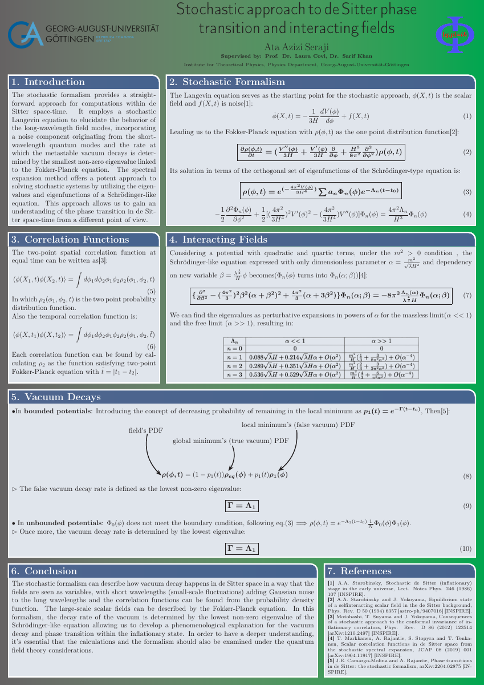

# Stochastic Approach to de Sitter Phase Transition and Interacting Fields

**Research Internship | Theoretical Physics | University of Göttingen**

**Author:** Ata Azizi Seraji  
**Supervisors:** Prof. Laura Covi, Dr. Sarif Khan  
**Institution:** Institute for Theoretical Physics, University of Göttingen

---

## Research Overview

This repository presents a research poster developed during an internship at the Institute for Theoretical Physics, University of Göttingen, under the supervision of Prof. Laura Covi and Dr. Sarif Khan.

The project investigates vacuum decay and phase transitions in de Sitter spacetime using the **stochastic formalism**, which describes the evolution of long-wavelength scalar-field fluctuations through Langevin and Fokker–Planck equations.

This framework provides an alternative perspective to the conventional semiclassical approach by relating metastable vacuum dynamics to the spectral properties of the Fokker–Planck operator.

## Theoretical Framework

### 1. Stochastic Formalism

The stochastic evolution of a scalar field is described by the Langevin equation:

```math
\dot{\phi}(t)=-\frac{V'(\phi)}{3H}+f(t)
```

where \(H\) is the Hubble parameter, \(V(\phi)\) is the scalar-field potential, and \(f(t)\) represents stochastic noise originating from short-wavelength quantum fluctuations.

The corresponding probability distribution evolves according to the Fokker–Planck equation:

```math
\frac{\partial \rho}{\partial t}
=
\frac{\partial}{\partial \phi}
\left(\frac{V'(\phi)}{3H}\rho\right)
+
\frac{H^3}{8\pi^2}
\frac{\partial^2 \rho}{\partial \phi^2}
```

### 2. Spectral Expansion

Through a suitable transformation, the Fokker–Planck equation can be expressed as a Schrödinger-like eigenvalue problem.

The probability distribution can then be expanded in terms of eigenfunctions:

```math
\rho(\phi,t)
=
e^{-\frac{4\pi^2 V(\phi)}{3H^4}}
\sum_n a_n \Phi_n(\phi)e^{-\Lambda_n(t-t_0)}
```

The eigenvalues determine the characteristic relaxation timescales of the stochastic system.

### 3. Correlation Functions

The stochastic formalism can also be used to study spatial and temporal two-point correlation functions.

These quantities describe correlations between scalar-field fluctuations at different spatial positions or times and can be obtained from the corresponding two-point probability distributions.

### 4. Interacting Scalar Fields

The research considers interacting scalar fields with quadratic and quartic contributions to the potential.

Perturbative expansions of the spectral eigenvalues are examined in different parameter regimes, including the massless and free-field limits.

## Vacuum Decay and Main Results

The stochastic description connects metastable-state decay to the spectral properties of the Fokker–Planck operator.

For the bounded and unbounded potential cases considered in the poster, the decay rate is identified with the lowest relevant non-zero eigenvalue:

```math
\boxed{\Gamma=\Lambda_1}
```

The research explores:

- Stochastic dynamics of scalar fields in de Sitter spacetime
- Langevin and Fokker–Planck equations
- Schrödinger-like spectral formulation
- Spatial and temporal correlation functions
- Perturbative expansions for interacting scalar fields
- Vacuum decay in bounded and unbounded potentials

## Research Poster

The complete research poster presents the theoretical formulation, relevant equations, and discussion of the results.

**[View the Full Research Poster (PDF)](Poster.pdf)**



## Scientific Relevance

This research investigates the relationship between stochastic processes, quantum field theory in curved spacetime, and metastable vacuum dynamics.

It demonstrates the use of spectral methods, differential equations, and analytical approximations in the study of physical systems influenced by quantum fluctuations.

## References

The poster includes references to foundational research on stochastic inflation, scalar-field correlation functions, and vacuum decay in de Sitter spacetime, including works by Starobinsky, Yokoyama, Markkanen and collaborators, and Camargo-Molina and Rajantie.

## Author

**Ata Azizi Seraji**  
M.Sc. Theoretical Physics — University of Göttingen

[GitHub Profile](https://github.com/Ata-Azizi)
